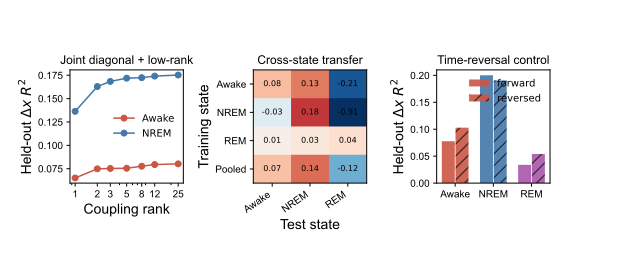

# 区域算子的联合拟合、跨状态迁移与时间反转

## 联合拟合

使用交替优化直接拟合

\[
\Delta x = (D + UV^T)x+b,
\]

其中 `D` 为对角自反馈，`UVᵀ` 为指定秩的跨区域算子；ridge 强度只由 validation episodes 选择。

| 状态 | rank 1 | rank 2 | rank 5 | rank 25/full |
|---|---:|---:|---:|---:|
| Awake `Δx R²` | 0.065 | 0.075 | 0.075 | 0.080 |
| NREM `Δx R²` | 0.136 | 0.163 | 0.172 | 0.175 |

结论：NREM 的对角 + rank-5 算子几乎保留完整矩阵的全部预测信息；Awake 在 rank 2 后也已进入收益很小的平台。这比事后 SVD 截断更稳定，说明应联合估计局部反馈和低秩耦合。

## 跨状态迁移

所有状态使用同一个由训练 episodes 定义的标准化坐标。rank-25 结果：

| 训练 → 测试 | Awake | NREM | REM |
|---|---:|---:|---:|
| Awake | 0.078 | 0.131 | -0.213 |
| NREM | -0.031 | 0.176 | -0.906 |
| REM | 0.015 | 0.028 | 0.042 |
| Pooled | 0.074 | 0.139 | -0.122 |

Awake 算子能迁移一部分到 NREM，但 NREM 算子不能迁回 Awake。Pooled 模型在 Awake 接近专用模型，却丢失约 21% 的 NREM `R²`。这支持“共享主结构 + NREM 状态调制”，而不是三个完全独立网络。REM 训练/测试 episode 太少，负迁移不能作机制解释。

## 时间反转

为避免因果高通本身制造方向，时间反转实验使用逐 episode 线性去趋势，并在每个方向重新训练和测试。rank-25：

| 状态 | forward `Δx R²` | reversed `Δx R²` |
|---|---:|---:|
| Awake | 0.078 | 0.103 |
| NREM | 0.200 | 0.191 |
| REM | 0.034 | 0.054 |

反向预测与正向相当，Awake/REM 甚至更强。因此当前 lagged operator 主要刻画可预测协方差和弛豫结构，不能证明传播方向、因果边或有效连接。NREM 只有很小的正向优势，后续需要按 episode bootstrap 判断是否超过不确定性。

200 次训练/test episode bootstrap 进一步确认：Awake 的 `forward - reversed R²` 中位数为 -0.025，95% 区间 [-0.055, -0.010]，所有重复均小于零；NREM 中位数为 0.008，但区间 [-0.024, 0.035] 跨零。因而目前没有任何状态提供“正向优于反向”的稳健证据。

## 当前判断

1. `D + UVᵀ` 是值得继续发展的最小区域方程。
2. 状态差异主要表现为 NREM 对共享结构的调制；下一步拟合共享 `U,V` 与状态特异 `Λ_s,D_s`。
3. 网络方向暂不解释。先寻找时间不对称事件、状态转换或视频行为驱动下的条件响应，再谈有效连接。

## 图示与数据依据

该图把联合低秩拟合、跨状态迁移和时间反转放在同一视觉比较中。正文中的数值分别来自 [`joint_rank_summary.csv`](../logs/regional_operator_validation/initial/joint_rank_summary.csv)、[`cross_state_transfer.csv`](../logs/regional_operator_validation/initial/cross_state_transfer.csv) 和 [`time_reversal.csv`](../logs/regional_operator_validation/initial/time_reversal.csv)。图与表共同支持“低秩结构可压缩，但方向性不可解释”的结论。
