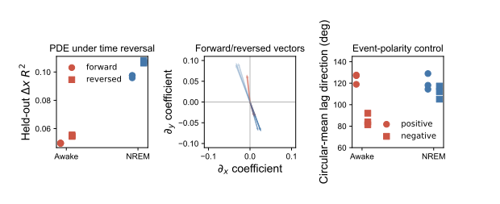

# 空间方向的反证实验

## 时间反转 PDE

对每个 episode 的空间 bin 轨迹整体反转，然后重新进行 train/validation/test 拟合。三组细胞样本：

| 状态 | forward 扩散+平流 `R²` | reversed `R²` |
|---|---:|---:|
| Awake | 0.0495–0.0499 | **0.0545–0.0555** |
| NREM | 0.0959–0.0976 | **0.1063–0.1081** |

反转后预测性不降反升。forward 平流向量约指向 `(+, -)`，reversed 约指向 `(-, +)`，方向大致翻转但幅度不完全对称。这说明空间 PDE 捕捉到了稳定的时空协方差轴，却没有给出“真实时间方向优于反向”的证据。

## 正峰与负谷事件

三组独立细胞样本均重新检测负向群体事件：

- Awake：242–251 个负事件；中位 lag-plane `R²=0.133–0.155`，空间置换 p=0.002；方向集中度 0.235–0.255，p=0.002。
- NREM：152–156 个负事件；中位 `R²=0.148–0.164`，空间置换 p=0.002；方向集中度 0.129–0.188，p=0.010–0.066。
- Awake 正峰方向为 119°–128°，负谷变为 81°–92°，具有明确极性依赖。
- NREM 正峰为 114°–129°，负谷为 105°–117°，两种极性较一致。

单一固定扫描方向不足以完整解释 Awake 的极性依赖，但仍可能贡献共同空间轴。NREM 更像一个固定优势轴上的双极性慢事件。

## 当前结论

1. 空间梯度和平流项是可靠的统计结构：跨细胞样本、事件极性和时间反转均能检测。
2. 它不是可靠的物理时间箭头：反向序列至少同样可预测。
3. 当前方程适合描述/生成时空协方差，不适合据此宣称有效连接或传播因果。
4. 下一步应比较 forward/reversed 的长期生成统计，并检查状态转换是否提供外部定义的时间箭头。

## 图示与数据依据

图把 forward/reversed PDE、正峰/负谷和扫描轴诊断并列。数据分别来自 [`logs/spatial_pde_library/`](../logs/spatial_pde_library/)、[`logs/spatial_bin_event_propagation/`](../logs/spatial_bin_event_propagation/) 和 [`scan_axis_diagnostics.csv`](../logs/spatial_scan_axis_diagnostic/initial/scan_axis_diagnostics.csv)。反向预测不弱于正向是限制因果解释的核心反证，而非附属控制。
