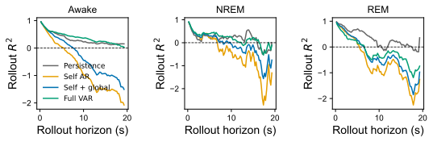

# 分区线性基线报告

对应 notebook：[261027分区线性基线.ipynb](../scripts/261027分区线性基线.ipynb)，长时计算脚本为 [261027分区线性基线.py](../scripts/261027分区线性基线.py)。底层结果为 [`model_summary.csv`](../logs/regional_linear_baselines/initial/model_summary.csv) 和 [`rollout_metrics.csv`](../logs/regional_linear_baselines/initial/rollout_metrics.csv)。

raw level 的一步预测很高：history=10 时 persistence 在 Awake/NREM/REM 的 `R²` 约为 0.953/0.885/0.967。这主要反映相邻帧高度相似，不能作为复杂动力学模型有效的证据。NREM 的 full VAR 提升到约 0.906，Awake 仅提升到约 0.955；REM 反而降到约 0.936。

约 3.86 s 时，Awake 的 persistence/full VAR `R²` 约为 0.522/0.563，NREM 为 0.313/0.417，REM 为 0.618/0.281。复杂模型在 REM 的明显退化说明样本不足和参数不稳；NREM 则存在可利用的跨区域结构。

基线的用途是设定最低门槛：后续模型必须同时超过 persistence/self 基线，并在跨 episode rollout 中保持稳定，而不能只追求一步拟合。
