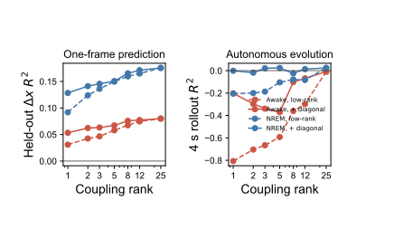

# 区域低秩算子扫描报告

对应 notebook：[261027区域低秩算子扫描.ipynb](../scripts/261027区域低秩算子扫描.ipynb)，长时计算脚本为 [261027区域低秩算子扫描.py](../scripts/261027区域低秩算子扫描.py)。底层结果位于 [`logs/regional_lowrank_sweep/initial/`](../logs/regional_lowrank_sweep/initial/)。

NREM 中 pure rank-5 的 `Δx R²` 约为 0.150，但约 4 s rollout `R²=-0.105`；保留独立对角自反馈后，diagonal+rank-5 的一步结果约为 0.151，而 rollout 恢复到约 0.024，已接近 full rank 的 0.024。Awake 的纯低秩模型在较低秩时也表现出强烈负 rollout。

图说明“奇异值能量高”不等于“动力学稳定”。低能量方向可能承担关键负反馈，因此紧凑区域模型至少需要 `D + UVᵀ`，其中 `D` 单独描述逐区自反馈，不能只保留低秩跨区域项。
