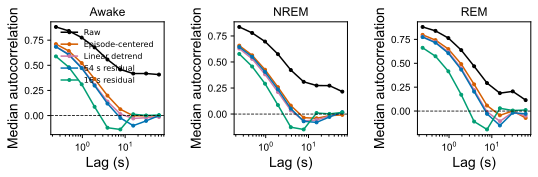

# 时间尺度分解报告

对应 notebook：[261027时间尺度分解.ipynb](../scripts/261027时间尺度分解.ipynb)。数据来自 [`autocorrelation_by_preprocessing.csv`](../logs/timescale_decomposition/initial/autocorrelation_by_preprocessing.csv) 和 [`episode_energy_fractions.csv`](../logs/timescale_decomposition/initial/episode_energy_fractions.csv)。

## 图的主要信息

raw trace 在 61.7 s 处的中位自相关仍约为 Awake 0.408、NREM 0.215、REM 0.115，看起来具有很长记忆；但逐 episode 去中心后，相同时间尺度分别约为 -0.004、-0.008、-0.072。16 s 因果高通后，约 7.7 s 的相关已经为负，61.7 s 附近接近零。

这说明 raw trace 的长相关主要由 episode 基线、状态差异和慢漂移贡献，而不是可以直接归因于局部神经动力学的 60 s 时间常数。建模时应同时报告 raw 与 episode-aware/high-pass 结果；如果只在 raw level 上取得高预测率，很可能主要是在预测慢基线。

## 对模型评价的要求

- 短期方程发现优先使用逐 episode 去趋势或因果高通表示。
- 长期生成模型仍应复现 raw level 的慢统计，但要把状态门控和漂移与局部动力学分开。
- 任何“长记忆”结论都必须对预处理敏感性负责，不能只展示单一自相关曲线。
