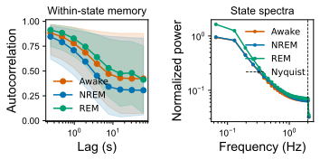
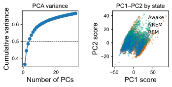
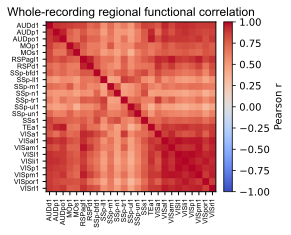

# 神经活动轨迹数据审计报告

对应 notebook：[261027神经活动轨迹数据审计.ipynb](../scripts/261027神经活动轨迹数据审计.ipynb)。底层结果来自 [`logs/audit_data/initial/`](../logs/audit_data/initial/)，尤其是 [`summary.json`](../logs/audit_data/initial/summary.json)、[`lag_autocorrelation.csv`](../logs/audit_data/initial/lag_autocorrelation.csv)、[`sample_pca.npz`](../logs/audit_data/initial/sample_pca.npz) 和 [`region_means.npz`](../logs/audit_data/initial/region_means.npz)。

## 数据规模与基本质量

数据矩阵为 28,801 帧 × 62,130 节点、float32，共 1,789,406,130 个数值；审计未发现 NaN 或 Inf。按同步估计的 4.1463 Hz 采样率，记录跨度约 6,945.93 s。状态包含 Awake 17,105 帧、NREM 9,622 帧和 REM 2,074 帧，共 98 个连续 episode。

图中的自相关与功率谱说明 raw trace 含有显著慢成分；但该图必须与时间尺度分解报告一起解释，不能把长相关直接当成神经元内在长记忆。

## 低维共同结构

在分层抽取的 1,024 个节点中，PC1、前 5 个和前 20 个主成分分别解释约 36.4%、53.6% 和 63.8% 方差。数据存在强共同模态，因此后续模型必须同时比较低秩公共驱动、区域耦合与局部项；仅凭 PCA 不能区分共同输入和网络传播。

## 区域相关结构

区域均值之间存在明显相关结构，但相关矩阵是对称统计量，不包含时间方向。它适合用于检查模型是否复现宏观协方差，不应直接解释为有效连接矩阵。

## 结论边界

这三幅图共同支持“强慢基线 + 低维共同模态 + 区域相关结构”的数据描述。它们尚不支持突触时延、方向性连接或单细胞 E/I 身份判断；这些问题需要时间反转、外生变量、干预或更高时间分辨率数据。
