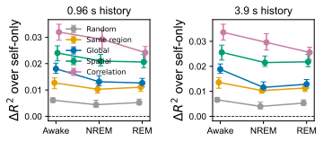

# 细胞级图模型反证报告

对应 notebook：[261027细胞级图模型反证.ipynb](../scripts/261027细胞级图模型反证.ipynb)，长时计算脚本为 [261027细胞级图模型反证.py](../scripts/261027细胞级图模型反证.py)。底层结果位于 [`logs/cell_graph_controls/`](../logs/cell_graph_controls/)。

图比较在已有单节点历史项之外加入全局均值、脑区均值或空间近邻信息所带来的 held-out `Δx R²` 增益。history=16 时，三次独立节点抽样中：

| 状态 | 全局增益中位数 | 脑区增益中位数 | 空间近邻增益中位数 |
|---|---:|---:|---:|
| Awake | 0.0183 | 0.0140 | **0.0258** |
| NREM | 0.0109 | 0.0094 | **0.0204** |

空间近邻在两种状态下均提供最大的稳定增益，支持局部空间结构具有预测价值；但增益仍然很小，而且图模型基于投影坐标构造。它不能证明单细胞突触连接，更不能给出 E/I 身份。合理表述是“空间邻域对下一帧增量具有可复现的条件预测价值”。
