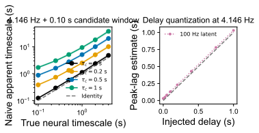

# 观测过程与可辨识性报告

对应 notebook：[261027观测过程与可辨识性.ipynb](../scripts/261027观测过程与可辨识性.ipynb)，长时仿真脚本为 [261027观测过程与可辨识性仿真.py](../scripts/261027观测过程与可辨识性仿真.py)。底层数据为 [`timescale_recovery.csv`](../logs/observation_identifiability/initial/timescale_recovery.csv) 和 [`delay_recovery.csv`](../logs/observation_identifiability/initial/delay_recovery.csv)。

## 时间常数偏差

仿真中的神经时间常数为 0.75 s、钙动力学时间常数为 0.35 s。降到 4.1463 Hz 后，表观时间常数的跨种子中位数约为 2.57 s；再加入 0.1 s 曝光积分后约为 2.65 s。图中的偏差说明从观测轨迹直接拟合出的衰减时间不能自动解释为膜或突触时间常数。

## 时延量化

在 100 Hz 潜变量上，0.025–1 s 延迟仍能形成连续估计；在当前成像采样和钙/曝光卷积后，估计只能落在 0、0.241、0.482、0.724、0.965 s 等帧格点上。真实 25 ms 与 50 ms 延迟均被估为 0 帧，100 ms 与 200 ms 都被压到约 1 帧。

## 结论

当前数据适合检验秒级群体演化和慢空间统计，不适合单独估计毫秒级突触时延。模型中可以加入时延作为敏感性分析或先验机制，但不能声称这些时延由本数据可靠辨识。
